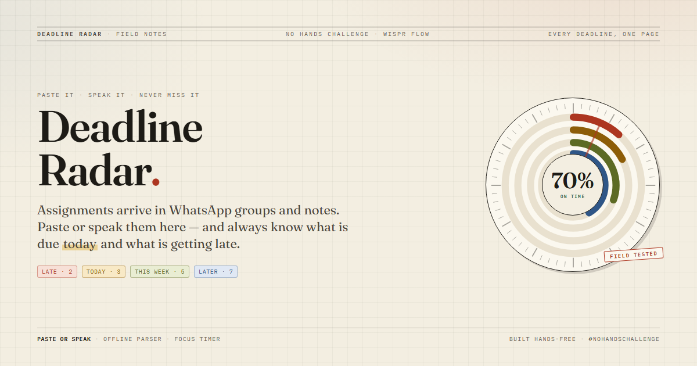
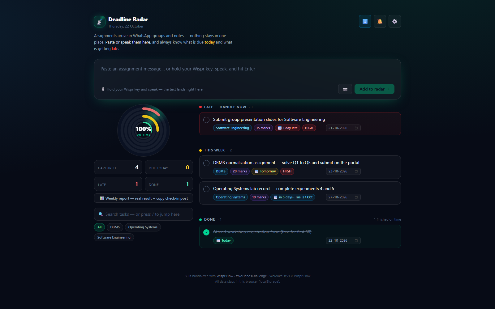

# 📡 Deadline Radar



[](https://kartikey-kesarwani-2005.github.io/Deadline-Radar/)
[](https://wisprflow.ai/)
[](https://wemakedevs.org/wispr)
[](./scripts/test-parser.mjs)

> College assignments arrive as random WhatsApp messages, screenshots and voice notes — and
> always risk getting missed. Deadline Radar turns any of them into one clean, date-sorted view:
> **what is due today, this week, and what is getting late.**

Built for the **No Hands: The Wispr Challenge** (WeMakeDevs × Wispr Flow) — Builders track.

## 🖼️ Screenshot



**Open it with data:** [live demo (samples preloaded)](https://kartikey-kesarwani-2005.github.io/Deadline-Radar/?demo=1)
— `?demo=1` adds the sample deadlines to the radar (merged with your own, deduped, never
replacing anything you captured). Add `&home=1` to open the dossier front page over the
sample file — a permanent, shareable door to it.

## ✨ Features

- **🧮 Exam coach — "Guess karun ya chhodun?"** — a tool no other tracker has, because
  they all stop at the due date: the decision every Indian exam hall asks under negative
  marking (JEE +4/−1, GATE, semester schemes). Bank the pakka-sahi marks, feed each guess
  an honest accuracy, and the ledger prints expected marks with-guesses vs. leaving them
  blank, the break-even accuracy (penalty ÷ (award + penalty)), and one straight verdict.
- **📸 The grade card as an actual photo** — the weekly report authors its own shareable:
  a crisp @2x PNG on Field-Notes paper — registration marks, rubber-stamped grade, the
  honest numbers, the credit line — native share sheet on phones, download elsewhere.
  No more blurry screenshots.
- **🎬 The front page — a dossier cover, not a splash** — first visit opens on a real
  front page: a stamped masthead, the **next deadline**, a **live table of contents**
  (late / today / this week / later / no date / done, with marks riding on them) and the
  **week ahead** as seven printed cells. Each contents row is a door: press *Late* (or
  <kbd>1</kbd>–<kbd>6</kbd>) and the sheet lifts straight onto that section; press the
  **OPEN THE FILE** stamp to enter at the top. It opens once per browser *session* (so judge reloads stay instant), and comes back
  any time from the masthead, the 🏠 toolbar button, Settings or <kbd>h</kbd>.
  `?home=1` is a permanent, shareable front-page link.
- **🗓️ Radar Almanac — the month as a printed planner** — one tap on **List / Almanac**
  (or press <kbd>v</kbd>) flips the radar from the urgency list to a real month grid: every
  day carries its pending marks, tiny subject-ink dots and a **late** stamp; today is ringed,
  and a picked day opens its own submission sheet *under* the calendar — tick, edit or start
  focus without leaving the month. The almanac keeps its own selected day, so browsing the
  month never silently filters the whole list; **List** in the day sheet is the explicit
  "open this day in the urgency list" path. The month summary says "Nothing in this month"
  instead of printing fake zeros, and undated work is named at the bottom so it does not
  vanish.
- **🖋️ Subject inks — one pen per subject** — every subject deterministically gets one of
  eight readable inks (hash of the name, so DBMS is always the same colour). The same ink
  colours the card spine and tag, the almanac dots, the LiveRail load bars and the weekly
  report table, with a printed legend for the month. Colour becomes a second index, not
  decoration — and it survives reloads without storing anything extra.
- **🧭 Zone index with live counts** — a chip row above the cards (Late · Today · Week ·
  Later · No date · Done) shows exactly how many tasks sit in each zone and jumps straight
  there; empty zones are visibly disabled instead of silently doing nothing. From the
  almanac it flips to the list first, then scrolls.
- **⏱️ Focus dock — the timer that stays put** — start a focus session and a small dock
  parks in the corner: live clock, task name, stop button, and a progress bar against the
  **learned** estimate from your own sessions (it says "≈12m left of 25m" or "4m over").
  The header chip scrolls away; this never does.
- **🚦 Pile-up watch — the clash detector** — one 20-mark task is a to-do; two heavy
  submissions on the *same day* is what sinks the week. When dated pending work stacks
  up, the desk prints a lane chip with the count and total marks (heaviest first) — tap
  it to filter the radar to exactly that day and stagger the work early. No other radar
  names the clash a day before it hits.
- **🖨️ A print stylesheet** — Ctrl+P (or the 🖨️ header button, or <kbd>p</kbd>) turns the
  radar into a clean wall-sheet: capture bar, controls, docks and rails drop out, the
  evidence stays on paper.
- **🕐 "Aaj ka timetable" — hour-by-hour day planner** — beyond the do-now pick, the radar
  prints an actual bell schedule for the day: pending work ranked by the do-now engine
  (late first, then marks-per-hour) laid into 25–90 min blocks from *this minute* until
  10 pm, with a 10-minute breath between rounds. Every block carries a ▶ button that
  starts a real focus session; work that cannot honestly fit reads as overflow — the
  timetable never fakes it. One tap copies it for the group.
- **🏅 Weekly report grade stamp** — the weekly report now ends like a real report card:
  a rubber-stamped **letter grade (A+…D) with an honest /100 score** — on-time rate
  carries 70%, the streak and a clean slate add up, and the week-over-week trend nudges
  it. Under 3 rated finishes it refuses to print a grade. It travels inside the
  check-in post text too.
- **🗄️ The DeskBar** — the **List / Almanac** switch, search, five-way sort, bulk select,
  the live zone index and the subject/day chips on one sticky paper strip **directly above
  the radar sections** — controls live where the cards are now, and they stay on screen
  while the radar scrolls. Calendar view hides list-only controls instead of leaving dead
  buttons behind.
- **🎯 Risk score dial (0–100)** — every pending card carries a small inked ring that
  folds the whole danger level into one glance: deadline proximity + marks + whether the
  learned effort even fits the days left + your own lateness history. Hover names every
  reason ("3d left · 25 marks — big one · usually 2d late in DBMS"). No other tracker
  scores a workload this honestly.
- **📋 "Plan banao" — one tap, a real study plan** — the card's 📋 button turns a scary
  deadline into a **day-by-day session checklist**: what to do in each round ("Re-read
  notes", "Solve the first half"…), on which date, ~how long, always ending in
  **submit**. Sessions are spaced between today and the due date from your learned pace;
  a task that no longer fits collapses into an honest single sprint. One tap copies the
  plan to the group chat.
- **🔥 12-week consistency heatmap** — a GitHub-style grid of the last 12 weeks on paper:
  ink density = tasks finished that day, an amber ring marks days that ran late, with the
  **best streak** ("best streak 5d") and the active one — the "am I actually showing up?"
  answer at a glance.
- **☑️ Bulk select** — toggle **Bulk select** in the DeskBar and the ticks become selection
  boxes: tick several cards, then one bar does it all — **Done ✓**, **+1 day** postpone,
  or **Delete** (with a group Undo). Spring cleaning without ten trips.
- **📅 Google Calendar quick add** — every dated card shows a **GCal** chip: one tap opens
  Google Calendar with a prefilled all-day event (title, marks, portal link) — no file
  download needed.
- **🎉 Radar-clear celebration** — tick the last pending task and confetti falls from every
  edge of the page: the radar earned its all-clear.
- **Capture anything** — paste a messy assignment message, or hold your Wispr key and speak it
  straight into the input box. Press <kbd>n</kbd> anywhere to jump to the input, <kbd>/</kbd> to search.
- **Full editing** — ✏️ on any card fixes title, subject, marks, date and priority; original
  captured text stays visible for reference.
- **Search + subject filter** — find any task instantly; subject chips filter the radar.
- **⌘K command palette** — one box for everything: type to search your radar, or run an action
  (new deadline, spoken briefing, weekly report, settings, export, jump to a section, sort).
  <kbd>↑</kbd><kbd>↓</kbd> to move, <kbd>↵</kbd> to open, <kbd>Esc</kbd> to close. `Ctrl+K` on
  Windows/Linux, the 🔍 chip in the header does the same.
- **↕ Order control** — each section can be read five ways: **Smart** (priority → nearest
  deadline → highest marks), **Due soonest**, **Marks high**, **Newest first** or **A → Z**.
  The pick is saved with your settings, so the radar opens the way you left it.
- **⏭ Postpone in one tap** — the ⏭ button on any pending card pushes the deadline one day and
  offers **Undo** right in the toast; **⧉ Duplicate** in the edit sheet makes a pending copy for
  a re-submission or the next round. Nothing needs a full edit trip.
- **An empty-desk page, not a dead end** — the empty state explains the three capture routes, offers three
  tappable sample messages (parsed live) and a full demo radar, instead of a dead end.
- **Screenshot capture** — 📷 button → pick a photo of a notice/syllabus/message → the task is
  read out of the image (needs any OpenAI-compatible vision key: Groq or Gemini free tiers work;
  presets are built into Settings).
- **Auto-extract** — task title, subject, deadline, marks and priority are pulled out of the text.
  - Built-in **offline parser** (dates like `Friday`, `25 Oct`, `25/10`, `tomorrow`, `2026-10-30`,
    weekdays, marks, subjects) — works with **zero setup**.
  - Optional **AI extract** (any OpenAI-compatible API) for messier messages — toggle in ⚙️ Settings.
- **Hinglish dates** — `agle somvar`, `25 tarikh`, `parso`, `kal`, `pichhle somvar` — the offline
  parser understands how students actually speak, not just textbook English.
- **Bulk capture** — paste a whole notice/syllabus (one deadline per line or sentence) → every
  task is extracted in a single go: *"Captured 3 deadlines from one paste ✓"*.
- **Clipboard auto-detect** — copy an assignment message (WhatsApp, notes…), switch back to the
  tab, and the radar itself asks *"📋 looks like a deadline — add it?"* — one tap.
- **Share to the radar (Android PWA)** — install the app, then any app → *Share → Deadline Radar*
  and the shared text is captured automatically (PWA Share Target).
- **Share** — 📤 on any card copies a ready-to-paste line + app link, for the study group chat.
  **📤 Share this week** in the rail sends the whole week's deadlines (late first) via the
  native share sheet on phone, clipboard on desktop.
- **🔗 Portal link capture** — assignment messages carry the Moodle/Classroom submit link;
  the parser extracts it (URL never leaks into the title or fakes a date), the card shows a
  one-tap **🔗 Portal** button, share text and the `.ics` calendar export carry it too. Can
  also be set/edited per task.
- **🔁 Re-capture updates** — teacher moved the deadline? Paste the same message again and
  the pending task updates **in place** (date/marks/link) with a *"📅 Fri → Mon updated"*
  flash — not dropped as a duplicate. Finished tasks are never reopened.
- **🔁 Weekly recurring deadlines** — paste *"DBMS lab every Friday"*, *"har somvar lab
  record"* or *"weekly viva due Monday"* and the card is stamped **🔁 weekly**: tick it off
  and the next occurrence rolls onto the radar automatically (undo pulls it back; the edit
  modal can turn the flag off), and the `.ics` export carries a real `RRULE:FREQ=WEEKLY`
  so phone calendars keep repeating it too.
- **Radar dashboard** — sections ordered by urgency: `Late` → `Due today` → `This week` → `Later`
  → `No date` → `Done`.
- **Radar dial** — the signature widget: a paper compass with concentric ink rings for Late / Due
  today / This week / Later, a slow rotating needle and the **on-time %** in the centre. Tap a ring
  to jump to that zone.
- **📈 6-week finish arc** — a six-bar sparkline in the rail: every bar is one week, green = on
  time, amber = late, with the running "N of M finished on time" score — the tool's *real result*
  over time, visible at a glance.
- **Celebration confetti** — ticking a task done bursts colourful confetti right from the click.
- **Premium feel** — a "Field Notes" design system: warm graph paper, editorial serif headlines,
  rubber-stamp chips and hard offset shadows. Cards glide in with a stagger and lift on hover;
  every animation respects the OS reduced-motion setting.
- **Desktop & phone modes** — Auto picks by screen size (or force either in ⚙️ Settings):
  phone mode is compact and thumb-friendly; desktop mode gets a wider canvas (up to 1536px),
  a sticky paper side rail that holds position while you scroll, and hover-reveal card actions.
- **⌨️ Desktop keyboard shortcuts** — `⌘K` / `Ctrl+K` command palette · `/` search · `n` new
  deadline · `b` spoken briefing · `w` weekly report · `v` list ↔ almanac · `p` print ·
  `h` front page · `?` shortcuts card · `Esc` close. A ⌨️ chip in the header opens the card;
  shortcuts never fire while you're typing in a field (or while the front page is still shut).
- **🎯 Marks at risk** — the radar counts *marks*, not just tasks: how many marks are already
  late and how many ride on this week's submissions. Shown in the rail, the weekly report and
  the voice answers.
- **🎯 "Ab kya karun?" (do-now engine)** — lists show what exists; this names the ONE
  task to start right now: marks-per-hour ROI weighted by urgency, so overdue and
  latest-start tasks jump the queue. A **⏱ focus timer** on every card tracks real
  minutes, so each subject's effort estimate comes from YOUR pace, not a guess —
  every pending card shows that **⏱ ≈ estimate** (🧠 = learned from your sessions).
- **🌦️ Deadline Weather** — the week as a weather forecast: ☀️ clear day, ⛅ light,
  🌧️ heavy (10+ marks), ⛈️ storm (3+ submissions or 25+ marks). Tap a day to filter the
  radar to it. Nobody else forecasts deadlines like weather.
- **🧠 Radar Brain (personal prediction)** — from your own finished work it learns per-subject
  rhythm — how often you're on time and how early/late you usually submit — and every card gets
  an honest chip like *"🧠 Usually 2.0d late — start by Wed"*.
- **🎙️ Ask the radar** — press 🎙️ Ask and speak: *"aaj kya hai"*, *"kitne marks risk me"*,
  *"what's late"* — it answers **out loud** (Chrome/Edge). And it takes **orders** too:
  say *"mark DBMS done"* and the card **ticks itself**, *"delete OS lab"* removes it,
  *"add viva Friday"* captures it — same mic, no hands. Ambiguous? It asks *"kaunsa?"*
  instead of guessing the wrong card.
- **🔊 Radar Samachaar (spoken briefing)** — one tap and the radar *speaks your whole day*:
  what's already late, what's due today and tomorrow, your on-time rate, and the single
  best next move. A voice-first product for a voice-first workflow.
- **⏳ Start-window alerts** — most trackers remind you the night *before it's due*; the radar
  tells you when you must **start** (your learned pace + hours/day that still fit): an amber
  strip on the dashboard, a line in the daily notification, and a mention in the spoken briefing.
- **🛰 Live countdown rail (big screens)** — every pending card carries a ticking `⏳ 2d 14h`
  chip, and on wide monitors a right-edge rail counts down to the *next* deadline in
  seconds-precision, beside a per-subject load meter. The dashboard breathes instead of
  sitting still — and no dead space on a desktop.
- **📈 Trend vs last week** — the weekly report compares finished / on-time counts with last
  week (green ↑ / red ↓) and totals your **⏱ focused hours** from focus-timer sessions — the
  "am I actually improving?" answer, plus a focus-hours pill on the dashboard.
- **Offline banner** — lose the connection and the radar says so: capture, parsing and data
  all keep working on-device; AI extract silently falls back to the offline parser.
- **Stats bar** — Captured / Due today / Late / Done pills next to the dial, plus a wide
  ⏱ focused-this-week pill fed by your timer sessions.
- **Daily reminder** — one browser notification a day when something is late or due today
  (enable it with the 🔔 button in the header).
- **On-time metric** — every tick records when you finished it, so the app shows *"N finished
  on time"* — the real result for your demo video — plus a **🏆 on-time streak** ("N in a row",
  stops at the first late finish), on the dashboard and in the weekly report.
- **Accessible dialogs** — every sheet (edit, settings, report, shortcuts, palette) shares one
  shell: focus moves in, `Tab` stays trapped, `Esc` closes only the top layer, body scroll is
  locked, and focus returns to the button you came from.
- **Weekly report** — one tap shows your real result (captured / finished / on time) and copies a
  ready-made check-in text for your #NoHandsChallenge post. It now includes a **🧠 per-subject
  pace table** — on-time %, your usual buffer (days early/late) and learned minutes-per-mark,
  worst subject first: the "which subject is actually eating my marks" answer no tracker gives.
  It also shows the **🏆 on-time streak** and **📊 pending-load bars** (marks still riding on
  each subject, heaviest first).
- **Undo delete** — deleting shows an instant Undo button, nothing is lost by a mis-tap.
- **Live radar sweep** — the header logo scans continuously; the **Late** counter pulses while
  something is overdue. The dashboard feels alive at a glance.
- **Backup & restore** — ⚙️ Settings exports every task as a JSON file and imports it back
  (merge-safe, deduped by id); localStorage-only apps deserve a backup button.
- **Crash-safe** — an error boundary keeps the radar alive; a bad render shows a reload card,
  never a blank white page.
- **PWA-ready** — favicon, web manifest and share preview (OG) tags; installable from the browser.
- **Daily check-in** — open the app, tick things off.
- **Everything in localStorage** — no account, no backend, data never leaves your browser
  (except the optional AI call you configure yourself).

## 🚀 Run it

```bash
npm install
npm run dev      # open http://localhost:5173
```

Build & deploy:

```bash
npm run build    # output in dist/
npm run preview  # test the production build locally
```

**Auto-deploy:** every push to `main` builds and publishes this repo to **GitHub Pages** —
the live demo link is `https://kartikey-kesarwani-2005.github.io/Deadline-Radar/`.

Manual alternatives: Vercel (import repo, framework = **Vite**, build = `npm run build`,
output = `dist`) or Netlify (same settings).

## 🎙️ Wispr Flow workflow (the challenge rule)

1. Hold your Wispr key → speak → text lands in the input box → press **Enter**.
2. Build/debug by voice: describe what to change to your AI coding tool, let it type the code.
3. Keyboard only for shortcuts (save, run, navigate).
4. Every week: **Wispr desktop app → Insights → usage card screenshot** → upload on the
   challenge site + post progress with `#NoHandsChallenge`.

## 🗺️ Roadmap (remaining challenge days)

- [x] Browser notification reminders for "Due today"
- [x] Marks-weighted priority sorting (high marks = top of the list)
- [x] Weekly report card ("saved N submissions from going late")
- [x] Screenshot → deadline (photo/notice extraction)
- [x] Backup & restore (JSON export/import)
- [x] Rich link preview (OG cover image)
- [x] ⌘K command palette + five-way order control
- [x] Postpone one day with undo + duplicate task
- [x] 🎯 Risk score dial on every card (0–100, multi-factor)
- [x] 📋 "Plan banao" — one-tap day-by-day study plan
- [x] 🔥 12-week consistency heatmap + streaks
- [x] ☑️ Bulk select (done / postpone / delete in one go)
- [x] 📅 Google Calendar quick-add per task + radar-clear celebration
- [x] 🕐 "Aaj ka timetable" hour-by-hour block planner
- [x] 🏅 Weekly report grade stamp (A+…D, refuses to fake a grade) + 📸 grade-card PNG share
- [x] 🗄️ DeskBar restructure — controls moved onto the list they act on
- [x] 🧮 Exam coach — negative-marking "guess ya chhod" ledger (JEE/GATE/sem schemes)
- [x] 🎬 Dossier front page — clickable live contents, next deadline, week strip, `h` to return
- [x] 🚦 same-day pile-up watch · 🖨️ print stylesheet
- [x] 🗓️ Radar Almanac month view (day sheet, month summary, subject legend) + List/Almanac toggle
- [x] 🖋️ Deterministic subject inks across cards, calendar dots, rail and report
- [x] 🧭 Zone index with live counts · ⏱️ sticky focus dock vs. learned estimate · front page any time (`h`)

## 📦 Submission checklist (by 30 Oct, 11:59 pm IST)

Everything prepped in this repo: **[SUBMISSION.md](./SUBMISSION.md)** (paste-ready write-up)
and **[DEMO-SCRIPT.md](./DEMO-SCRIPT.md)** (timed 2-minute shot list).

- [ ] Deployed link ✅ (GitHub Pages, auto-deploys on push)
- [ ] Demo video (≤ 2 minutes)
- [ ] Wispr usage card screenshot (desktop app → Insights)
- [ ] Few lines: problem, who it's for, how Wispr was used (draft in SUBMISSION.md)

## 🧪 Tests

```bash
npm test       # parser + bulk + backup + voice + sort + countdown + risk/plan/heat/timetable/grade/marking-coach/almanac/inks (281 checks)
npm run test:ai # end-to-end AI paths (needs AI_KEY env)
```
